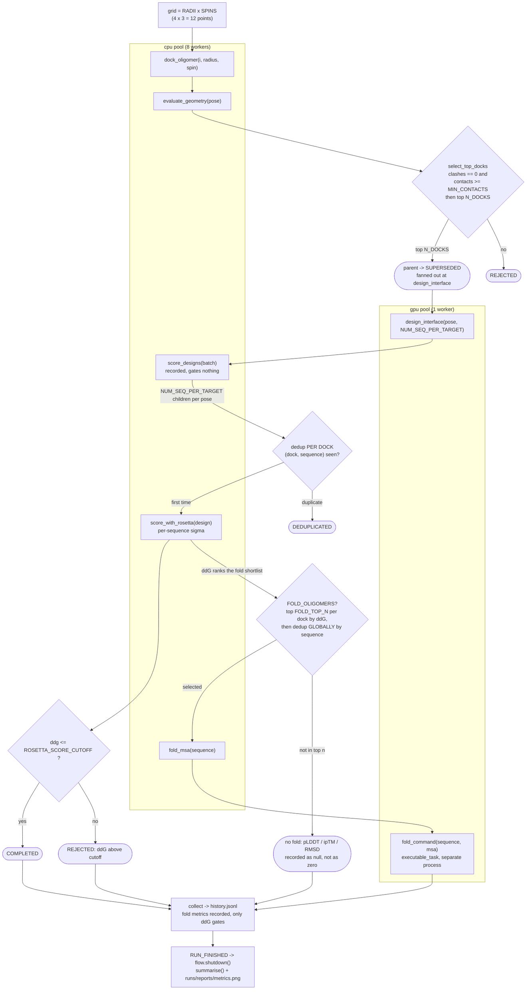

# What `1_sync/v2/main.py` actually executes

Stage 1 of Matteo's roadmap: naive. Every dock finishes before selection, every design
finishes before scoring, nothing refills, nothing adapts. Kept in sync with the code, not
aspirational. Regenerate by hand whenever `run()` changes.

For the **science** this is modelling, see `../../pipeline_flow.md`. This file is only about
what the orchestration does. Where the two differ, that difference is either a deliberate
simplification noted below or a bug.



## What the orchestration is doing that is worth knowing

**Nothing declares the dependency graph.** AsyncFlow derives it from the data flowing
between calls. `fold(sequence, await fold_msa(sequence))` is an ordering constraint because
of the argument, not because anything said so.

**The stage bodies are swappable.** `--backend simulated` (default) or `--backend actual`.
Nothing in `run()` names a mock. That is the property that has to survive contact with the
cluster: if switching backends needs changes in `run()`, the orchestration was carrying a
mock-shaped assumption.

**`fold` is an `executable_task`, not a function task.** Deliberately a separate process
with a command-line interface, because that is how the real thing has to work: ColabFold,
ProteinMPNN and PyRosetta each need their own environment and conflict irreconcilably.
Replacing the stub means changing a command string.

**Rosetta noise is per sequence, not per stage.** `_sequence_sigma` seeds on the sequence,
so rescoring the same candidate twice draws from the same distribution. This models Laura's
measured finding that one sequence reproduces to 0.092 kcal/mol and another to 1.055 in the
same run. A uniform sigma, which is what the earlier version of this demo used, would erase
the only thing that makes replication worth doing.

**`--` in the summary table means never folded, not a failed fold.** With `FOLD_TOP_N = 1`
most candidates are legitimately not folded, and the report drops those from its histograms
instead of plotting them as zero.

## Deliberate simplifications, and what each hides

| here | reality | why it is acceptable for stage 1 |
|---|---|---|
| grid is a plain `RADII x SPINS` cross product | commit `3a58ad5` dropped the redundant spin sweep for symmetric components; `66c3568` added flip, idealisation and a radius window | the grid's *shape* does not change what the orchestration must do, only how many docks arrive. Fix before quoting any dock count. |
| one-component only | `config["scaffold_pdb_b"]` switches to a two-component path with its own scoring | two-component is actively moving under Laura's hands; pinning it now would pin the wrong thing |
| `design_interface` pinned to the GPU pool | it runs on either, and Laura endorsed choosing at runtime | stage 1 makes no runtime decisions by definition. This is the line stage 3 changes. |
| `dedup_sequences` is ours | CageFlow has no sequence dedup of its own; only the fold path dedups, and globally | ours is a superset and it is recorded per candidate, so nothing is lost |
| relax is absent | disabled upstream, config key now raises | Laura confirmed 2026-09-25 it may stay carried as long as it is commented out |
| `select_top_docks` is a hard barrier | it is a barrier in CageFlow too | this one is faithful. Removing it is stage 2's job, not a fix. |

## The coupling stage 2 should attack first

Folding needs only the sequence. Rosetta needs the threaded structure. On the science they
are independent and Laura says so explicitly. But `main.py` still waits for every ddG before
folding anything, because CageFlow picks which sequences to fold by **ranking on ddG**
(`fold_top_n`, default 1).

So the branches are serialised by a *selection policy*, not by a data dependency. That is
the clearest, smallest, most defensible thing for stage 2 to break: fold speculatively as
sequences arrive and cancel the ones a later ddG disqualifies, or keep the ranking and
accept the barrier. Either way it becomes a decision the system makes rather than an
accident of how the loop was written, which is the whole argument of the thesis in
miniature.

## Running it

```bash
uv run python -m demos.cnio.1_sync.v2.main                    # mocked, seconds
uv run python -m demos.cnio.1_sync.v2.main --backend actual   # raises, by design
```

Outputs land in `runs/`: `history.jsonl` (per-candidate record) and `reports/metrics.png`.
Laura's real `history.jsonl` is in `../../reference/` and is never written to by a run.
