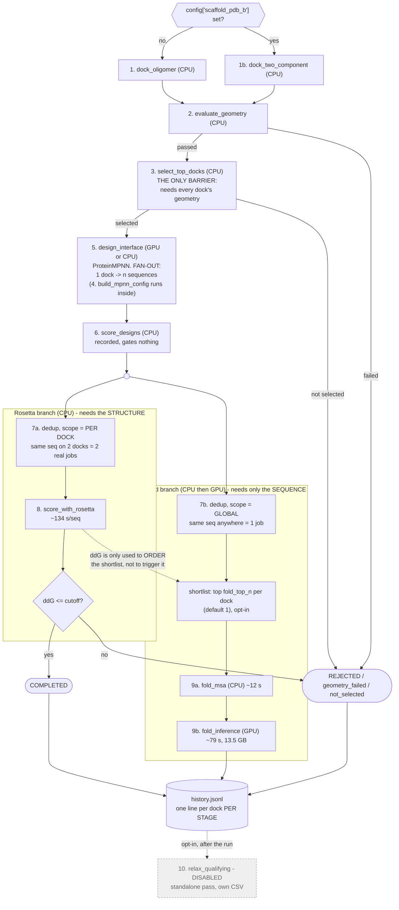

# CageFlow: what the pipeline actually is

The canonical map of the science, as CNIO runs it. Not what our demo executes (that is
`1_sync/v2/pipeline_flow.md`) and not what we wish it were.

Sources, in order of authority:

1. **Laura's filled-in operation map**, 2026-09-10, her answers in her words. The original PDF is
   the only remaining copy; the quotes below are verbatim from it.
2. **Her `integrating_agent_demo` branch** at `eb6113d` (2026-09-23), and especially the design
   notes she keeps in `notes/` there, which are more current than the map.
3. Meeting notes, where neither of the above covers it.

Where 1 and 2 disagree, 2 wins and the disagreement is called out, because the branch moved six
commits after the map was written.

---

## The flow



**How to read the two branches.** They both start from the same designed sequences (the `( )`
split) and run **at the same time**. Neither feeds the other. The Rosetta branch decides
pass/fail; the fold branch only produces numbers that get recorded.

The one dotted arrow between them is the thing to understand: **ddG does not trigger folding, it
only sorts the queue.** Folding is configured to run on the best `fold_top_n` sequences per dock,
and "best" is currently measured by ddG. So the fold branch waits, not because it needs anything
Rosetta computed, but because it wants to know which sequence is worth folding. Take that ranking
away (fold the first N, or fold everything) and the branches become fully parallel today.

That is why it is drawn dotted and labelled: it is a policy, not a dependency, and it is stage 2's
first target.

---

## Reading the diagram

**Only one thing gates.** The Rosetta ddG cutoff at step 8 is the single pass/fail in the whole
pipeline. Everything else is recorded. Laura, on whether fold quality should gate too: *"it's still
too early to depend on any single or group of weighted metrics... when you actually talk to the
scientists behind it, they'll admit they only really cared about ddG + final human validation. So I
think we want to score and keep as much as possible."* So pLDDT, ipTM and RMSD are computed, paid
for, and must be written down, but they disqualify nobody.

**The two branches after design are independent, and this is verified in the code, not inferred.**
Rosetta is structure-based: it needs threading, so it must follow ProteinMPNN. Folding is
sequence-based only. Laura: *"folding (and associated scores) are only based on sequence. They
don't need to wait for the Rosetta scores... it is actually independent, so it could happen at the
same time."*

The obvious objection is that folding still looks at ddG, so how can it be independent?
`_rank_sequences_for_fold()` (`CageFlow.py:2307`) answers it:

```python
per_seq_ddg = (rosetta_scores.get(dock_index) or {}).get("per_seq_ddg") or []
scored = [(v, j) for j, v in enumerate(per_seq_ddg) if v is not None and v != 0.0]
if not scored:
    scored = [(d["score"], j) for j, d in enumerate(designs) if d.get("score") is not None]
```

ddG is a **preference, with a fallback**, not a requirement. Its own docstring: *"Prefers real
Rosetta ddG where it exists and falls back to the ProteinMPNN score otherwise... so folding still
works on a pipeline that never reached Rosetta, just ranked on weaker evidence."*

So there are three separate statements, and only the first two are about dependency:

1. **Folding a given sequence needs nothing from Rosetta.** True, always.
2. **Choosing which sequences to fold needs nothing from Rosetta either.** Also true: without ddG
   it ranks on the ProteinMPNN score, by design.
3. **Folding nonetheless happens after Rosetta today.** True, but only because `run_cage_flow()`
   calls the stages in source order. That is sequencing, not a dependency.

The cost of using the weaker ranking is that you may fold a sequence that a later ddG would have
shown was not worth folding. That is a *quality* trade, not a correctness one, and it is exactly
the sort of thing the decision layer should be weighing. With `fold_top_n=1` and folding the most
expensive stage in the pipeline, it is a real trade rather than a token one.

This is the clearest thing for stage 2 to attack, precisely because nothing has to be proved safe
first: the fallback path already exists and Laura already wrote it.

**Dedup happens twice, at two different scopes, on purpose.** Per dock before Rosetta, globally
before folding. Laura's reasoning: a ddG depends on the sequence *and* the interface it sits in, so
the same sequence under two docks is two real calculations; a fold depends on the sequence alone,
and RMSD superimposes before measuring, so the dock's rigid-body placement drops out. Her caveat is
load-bearing: global dedup *"holds only because docking moves a fixed scaffold. A protocol that
flexed the backbone per dock would have to make this per-dock again."* Duplicates are common because
ProteinMPNN samples at low temperature to stay near the native sequence.

**`select_top_docks` is the pipeline's only barrier.** It cannot rank until every dock's geometry is
in. Whether stage 2 keeps it as a barrier or selects incrementally is an open design question, not a
given.

**Relax is off.** In red on Laura's map: *"NO LONGER RELAXING FOR NOW - TOO EXPENSIVE AND
UNPREDICTABLE."* Commit `a46c8f3` deleted `rosetta_relax` from the config, and
`CageFlow._reject_rosetta_relax()` now raises if an old config still carries the key, so a stale
config fails loudly instead of quietly producing relaxed numbers that get compared against
unrelaxed ones. FastRelax minimises the backbone, which decouples the score from the radius/spin/flip
degrees of freedom being ranked, costs roughly 61x plain packing, and improved no geometry metric.
What survives is *packing*, which lets side chains breathe without moving the backbone. Laura
confirmed on 2026-09-25 that we may carry the stage as long as it stays commented out, which is what
`stages/` does: present, `enabled=False`, never scheduled.

---

## Measured costs

From run `9759675` (2 docks x 2 sequences, folding on), recorded in `notes/fold_oligomer.md`. These
replace every guess we were carrying.

| stage | pool | n | total | max/task | cpu/elapsed | peak RSS |
|---|---|---|---|---|---|---|
| `dock_oligomer` | CPU | 24 | 4.5 s | 0.3 s | 0.97 | 118 MB |
| `evaluate_geometry` | CPU | 24 | 1.0 s | 0.1 s | 1.15 | 121 MB |
| `design_interface` | GPU | 2 | 87.6 s | 44.0 s | 1.01 | 1536 MB |
| `score_with_rosetta` | CPU | 4 | 537.2 s | 141.2 s | 0.99 | 1437 MB |
| `fold_oligomer` | GPU | 1 | 110.8 s | 110.8 s | **0.61** | **13489 MB** |

Three consequences Laura draws from that table, all of which affect how we submit jobs:

- **Folding needs about 13.5 GB**, roughly 9x the design stage. The 8 GB in older configs OOMs;
  `config.fold.json` asks for 32 GB.
- **The fold's cpu/elapsed of 0.61 is the only value below 1.0**, because about 40 of those 110
  seconds were spent waiting on `api.colabfold.com` *while holding an A100*. That is what motivated
  splitting the MSA off onto a CPU pool. A GPU idling on network I/O is precisely the waste this
  thesis claims to attack, and here it is, measured, in the collaborator's own logs.
- **Rosetta drifted 33% between runs** (537.2 s vs 407.5 s) on bit-identical seeded input producing
  bit-identical scores. Size Slurm walltime from the max, never the mean.

Laura's map adds two figures the run did not cover: MSA 0.2 min (12.2 s) and GPU inference 1.3
min/sequence (79.4 s), which is the split version of the 110.8 s above.

**One unresolved disagreement.** The map says interface design costs 0.37 min/dock (22.2 s) on an
A100; run 9759675 measured 44.0 s. Two-fold apart. Ask Laura which conditions each refers to before
either number goes in a proposal.

---

## The noise finding, which matters more than the costs

`measure_rosetta_noise.py`, 8 replicates of one sequence on the same backbone and symdef:

| sequence | mean | stdev | spread | 2 sigma |
|---|---|---|---|---|
| dock 3, sample 2 | -8.221 | 0.092 | 0.267 | 0.18 |
| dock 4, sample 1 | -1.645 | **1.055** | 3.395 | 2.11 |

The packer is unseeded, so rescoring the same sequence gives a different ddG. The headline is not
the magnitude but its spread: **an 11x difference in standard deviation between two sequences in the
same run.** Our own earlier mock asserted a uniform 0.3 kcal/mol, which happens to fit the first
sequence and is badly wrong for the second.

Why this is the most useful thing on this page:

- **A single scoring run cannot reliably rank designs.** For a noisy sequence the 2-sigma band
  exceeds 3 kcal/mol, wider than the gap between the docks being compared.
- It explains an observation that otherwise looks like a bug: dock 4 sample 1 scored -3.999 in one
  run and -1.272 in an identical rerun. Both sit inside its measured range. Nothing was broken.
- Laura's own conclusion, unprompted by us: replication should be **adaptive** (replicate the noisy
  ones) rather than a uniform N, *"since most sequences don't need it."*

That is the thesis's stochasticity dimension, measured by the domain scientist, in her own repo,
before we asked. It should be cited as such rather than argued for from first principles.

She also notes the variance may itself be a design signal (a sequence whose packing settles into
different minima run to run is plausibly a more frustrated interface), and that she has not decided
whether to seed the packer, because seeding would *hide* the variance rather than remove it.

---

## Where the intelligence layer could attach

Two openings, both from Laura's own words rather than from us. Recorded here because they are
properties of the science, not of our design.

**1. Adaptive replication.** Her noise measurement, above, concludes that replication should target
the noisy candidates rather than apply a uniform N. That is a decision under a budget: spend a
rescore on a candidate whose ranking is genuinely uncertain, or spend it exploring a new one. It is
the cheapest possible demonstration of the thesis's claim, and the domain scientist asked for it
first.

**2. "Final human validation" is a queue, and queues can be ranked.** Laura's answer on gating is
that only ddG gates and everything else is recorded, because the real decision procedure is "ddG +
final human validation" -- a scientist eventually looks at the survivors and picks.

That step is currently unmodelled, and it is arguably the best place for the decision layer to sit.
The system does not need to replace the scientist's judgement, which is the part that is genuinely
too early to automate and which Laura is right to defend. It needs to decide **what to put in front
of them, in what order, and how many**. That is a ranking-under-budget problem over exactly the
metrics already being recorded and currently gating nothing (pLDDT, ipTM, RMSD, ProteinMPNN score,
ddG and its per-candidate noise), and it sidesteps the objection that nobody knows how to weight
them: we do not have to, because a human still decides. We only have to beat an arbitrary order at
surfacing the candidates worth a look.

It also fits what the pipeline already does. Nothing is thrown away; every candidate is in
`history.jsonl` with every measurement. A ranking layer reads that and changes nothing about the
science. Worth putting to Laura and Roger directly, because if they agree it turns "the
intelligence layer" from an abstraction into a feature with a user.
