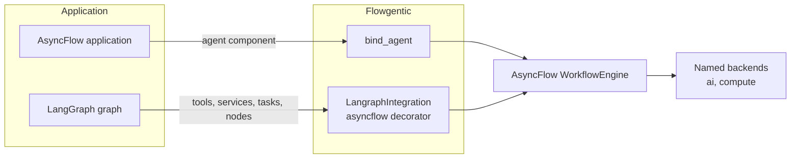
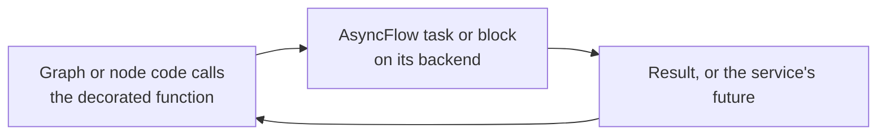
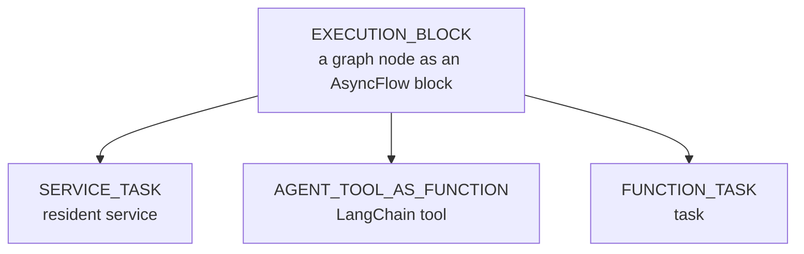

# Architecture

Flowgentic sits between an application's agent code and RADICAL AsyncFlow. It
has two independent parts: `bind_agent`, which runs an agent component as an
AsyncFlow task, and `LangraphIntegration`, which runs a LangGraph graph's
tools, services, tasks and nodes as AsyncFlow tasks. AsyncFlow schedules every
task on a named backend.

## Modules

| Module | Contents |
| --- | --- |
| `flowgentic.agent` | `bind_agent` and `AgentTask`: an agent component as an AsyncFlow task, each call an `invoke_agent` span; see [Telemetry](features/telemetry.md) |
| `flowgentic.langGraph.main` | `LangraphIntegration`: creates and shuts down the `WorkflowEngine` |
| `flowgentic.langGraph.execution_wrappers` | `AsyncFlowType`, the `asyncflow` decorator, the handoff tool, `BaseLLMAgentState` |
| `flowgentic.langGraph.memory` | `MemoryConfig`, `MemoryManager` and the integration's `LangraphMemoryManager` |
| `flowgentic.langGraph.mutable_graph` | `MutableGraph`: a graph whose nodes change at runtime |
| `flowgentic.langGraph.utils` | An LLM router and fan-out for supervisor graphs |
| `flowgentic.langGraph.base_components` | `BaseToolRegistry`: a base class that registers an application's tools and tasks by name |
| `flowgentic.utils.llm_providers` | `ChatLLMProvider`: OpenRouter, OpenAI and Ollama chat models |
| `flowgentic` | `configure_logging`: prints Flowgentic's log records, which import leaves to the application; see [Logging](features/logging.md) |
| `flowgentic._asyncflow` | Private: the one module that calls AsyncFlow. `bind_agent`, `LangraphIntegration`, the `asyncflow` decorator and the handoff tool open and close engines and register tasks, services and blocks through it. It carries the caller's trace context into each task and service |
| `flowgentic._telemetry` | Private: the OpenTelemetry tracer, the span and attribute names, and the trace-context carrier |

Academy agents' actions run in AsyncFlow tasks without a Flowgentic module:
see [Academy actions as AsyncFlow tasks](guides/academy-on-asyncflow.md).

The [API reference](api/flowgentic/index.md) documents each module.

## How a decorated call runs

Each `asyncflow` decorator registers the function with AsyncFlow. A call
submits one task or block and awaits it, with no retry and no timeout:

A node is usually an `EXECUTION_BLOCK`, and the tools, tasks and services it
calls are AsyncFlow tasks inside that block. AsyncFlow's documentation
describes [blocks](https://radical-cybertools.github.io/radical.asyncflow/composite_workflow/?h=block#example-blocks-with-dependency).

[LangGraph on AsyncFlow with Flowgentic](guides/langgraph-on-asyncflow.md)
describes each flow type, and [Retries and timeouts](guides/retries-and-timeouts.md)
where retries and deadlines belong.
