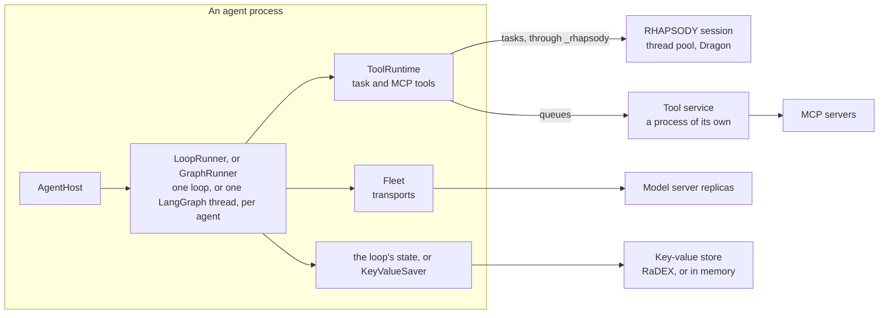
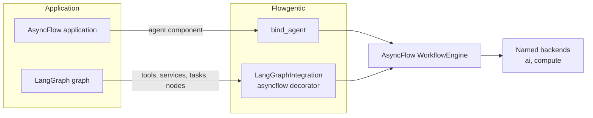
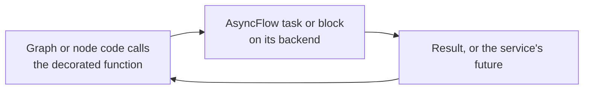
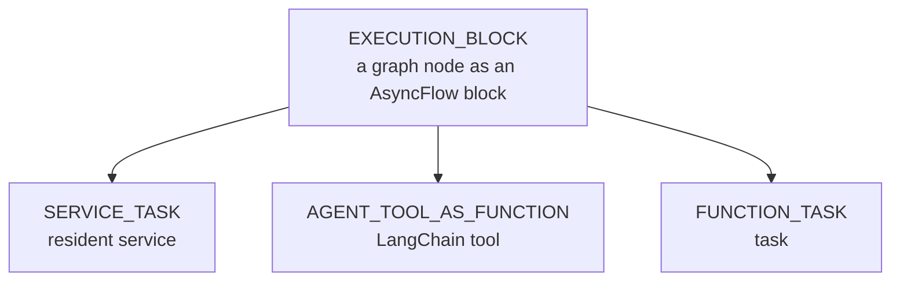

# Architecture

Flowgentic has two paths for agents on HPC resources.

- **Agents at scale** runs many thousands of agents per process. An agent
  host drives them through a runner: Flowgentic's own agent loop, or, with
  the `langgraph` extra, LangGraph's; their tools run inline, as RHAPSODY
  tasks or through a shared tool service; their model calls go to a fleet of
  model server replicas, through transports to OpenAI-compatible servers; and
  a suspended agent's state goes to a key-value store in the allocation's
  memory. Flowgentic reaches RHAPSODY
  through one module, `flowgentic._rhapsody`.
- **The AsyncFlow path** sits between an application's agent code and RADICAL
  AsyncFlow. `bind_agent` runs an agent component as an AsyncFlow task, and
  `LangGraphIntegration` runs a LangGraph graph's tools, services, tasks and
  nodes as AsyncFlow tasks. AsyncFlow schedules every task on a named backend.
  Flowgentic reaches AsyncFlow through one module, `flowgentic._asyncflow`.

`accept`, which decides whether an agent's output may become HPC work, belongs
to neither: it calls no runtime itself, though its producer and checks may.

## Agents at scale

The application creates everything outside the agent process, and passes it
in: the RHAPSODY session, the tool service's queues, the replicas' transports
and the store. So the same agent code runs on a laptop, with a thread pool,
the standard library's queues and an in-memory store, and on an allocation,
with Dragon, its queues and RaDEX.

The agent host knows no framework, and the tools no framework either: each
framework has a runner and an adapter that turns tool declarations into its
own tools. `flowgentic.loop` is Flowgentic's own loop, the path's runner, on
OpenAI-format messages and the fleet's transports, which runs the
declarations itself and saves a suspended agent's messages to the store; it
needs no LangGraph. `flowgentic.langgraph` holds LangGraph's runner, with its
checkpointer, and `flowgentic.langchain` adapts LangChain's models, messages
and tools to both, with the `langgraph` extra. A
private module, `flowgentic._agents`, carries the current agent and its state
through asyncio's context, so the fleet and the tools count what each agent is
doing without being passed the agent.

| Module | Contents |
| --- | --- |
| `flowgentic.host` | `AgentHost`, `Runner`, `Agent`, `HostReport`, `AgentStates`, `register_pending`: runs agents and counts them by state; see [Agent host](features/agent-host.md) |
| `flowgentic.tools` | `task_tool`, `mcp_tool`, `ToolRuntime`, `TaskOrder`: where each tool runs; see [Tool placement](features/tools.md) |
| `flowgentic.tools.service` | `serve`, `ToolServiceClient`, `ToolService`: one process that calls MCP tools for many agent processes; see [Tool service](features/tool-service.md) |
| `flowgentic.tools.mcp` | `SupervisedMcpPool`: MCP clients whose failures stay their own |
| `flowgentic.store` | `KeyValueStore`, `RadexStore`, `MemoryStore`: stores in the allocation's memory; see [Checkpointer](features/checkpointer.md) |
| `flowgentic.fleet` | `Fleet`, admission, routing, `Recovery`, `Transport`, `Reply`, `OpenAITransport`: model calls to replicas; see [Fleet](features/fleet.md) |
| `flowgentic.langgraph` | `GraphRunner`, `route_tool_calls`, `bind_tools`, `KeyValueSaver`: LangGraph's runner, tool adapter and checkpointer |
| `flowgentic.loop` | `LoopRunner`, `LoopOutput`, `Interrupt`: Flowgentic's own agent loop, on OpenAI-format messages, with no extra; see [Agent loop](features/agent-loop.md) |
| `flowgentic.langchain` | `ChatModelTransport`, `FleetChatModel`, `to_ai_message`, `inline_tool`: LangChain as an adapter to the fleet and the loop; the `langgraph` extra |
| `flowgentic._agents` | Private: the current agent, its state, and the futures of the tasks it waits on |
| `flowgentic._rhapsody` | Private: the one module that calls RHAPSODY. It submits task tools' tasks to the caller's session, in the caller's trace context. It never creates a backend |

[Agents at scale](guides/agents-at-scale.md) puts the parts together.

## The AsyncFlow path

### Modules

| Module | Contents |
| --- | --- |
| `flowgentic.agent` | `bind_agent` and `AgentTask`: an agent component as an AsyncFlow task, each call an `invoke_agent` span; see [Telemetry](features/telemetry.md) |
| `flowgentic.acceptance` | `accept`, `Rejected`, `NotAccepted`, `Outcome` and `Attempt`: an agent's output checked, re-asked for and accepted or replaced by a fallback, each call an `accept` span; see [Acceptance](features/acceptance.md) |
| `flowgentic.langgraph.main` | `LangGraphIntegration`: creates and shuts down the `WorkflowEngine` |
| `flowgentic.langgraph.execution_wrappers` | `AsyncFlowType`, the `asyncflow` decorator, the handoff tool, `BaseLLMAgentState` |
| `flowgentic.langgraph.utils` | An LLM router and fan-out for supervisor graphs |
| `flowgentic.langgraph.base_components` | `BaseToolRegistry`: a base class that registers an application's tools and tasks by name |
| `flowgentic.utils.llm_providers` | `ChatLLMProvider`: OpenRouter, OpenAI and Ollama chat models |
| `flowgentic` | `configure_logging`: prints Flowgentic's log records, which import leaves to the application; see [Logging](features/logging.md) |
| `flowgentic._asyncflow` | Private: the one module that calls AsyncFlow. `bind_agent`, `LangGraphIntegration`, the `asyncflow` decorator and the handoff tool open and close engines and register tasks, services and blocks through it. It carries the caller's trace context into each task and service |
| `flowgentic._telemetry` | Private, for both paths: the OpenTelemetry tracer, meter and logger, the span, metric, event and attribute names, the content switch, and the trace-context carrier |

Academy agents' actions run in AsyncFlow tasks without a Flowgentic module:
see [Academy actions as AsyncFlow tasks](guides/academy-on-asyncflow.md).

The [API reference](api/flowgentic/index.md) documents each module.

### How a decorated call runs

Each `asyncflow` decorator registers the function with AsyncFlow. A call
submits one task or block and awaits it, with no retry and no timeout:

A node is usually an `EXECUTION_BLOCK`, and the tools, tasks and services it
calls are AsyncFlow tasks inside that block. AsyncFlow's documentation
describes [blocks](https://radical-cybertools.github.io/radical.asyncflow/composite_workflow/?h=block#example-blocks-with-dependency).

[LangGraph on AsyncFlow with Flowgentic](guides/langgraph-on-asyncflow.md)
describes each flow type, and [Retries and timeouts](guides/retries-and-timeouts.md)
where retries and deadlines belong.
