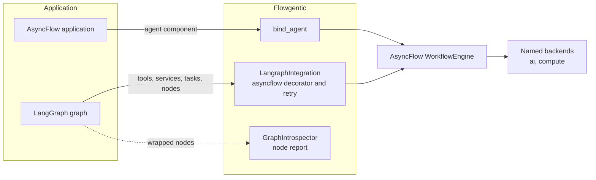
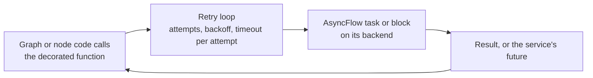
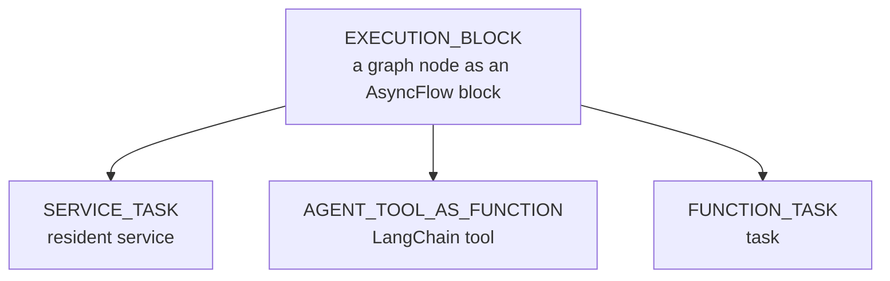

# Architecture

Flowgentic sits between an application's agent code and RADICAL AsyncFlow. It
has two independent parts: `bind_agent`, which runs an agent component as an
AsyncFlow task, and `LangraphIntegration`, which runs a LangGraph graph's
tools, services, tasks and nodes as AsyncFlow tasks. AsyncFlow schedules every
task on a named backend.

## Modules

| Module | Contents |
| --- | --- |
| `flowgentic.agent` | `bind_agent` and `AgentTask`: an agent component as an AsyncFlow task |
| `flowgentic.langGraph.main` | `LangraphIntegration`: creates and shuts down the `WorkflowEngine` |
| `flowgentic.langGraph.execution_wrappers` | `AsyncFlowType`, the `asyncflow` decorator, the handoff tool, `BaseLLMAgentState` |
| `flowgentic.langGraph.fault_tolerance` | `RetryConfig` and the retry loop around every decorated call |
| `flowgentic.langGraph.memory` | `MemoryConfig`, `MemoryManager` and the integration's `LangraphMemoryManager` |
| `flowgentic.langGraph.mutable_graph` | `MutableGraph`: a graph whose nodes change at runtime |
| `flowgentic.langGraph.utils` | An LLM router and fan-out for supervisor graphs, and graph rendering |
| `flowgentic.langGraph.base_components` | `BaseToolRegistry`: a base class that registers an application's tools and tasks by name |
| `flowgentic.utils.telemetry` | `GraphIntrospector` and the Markdown node report |
| `flowgentic.utils.llm_providers` | `ChatLLMProvider`: OpenRouter, OpenAI and Ollama chat models |
| `flowgentic.utils.logger` | `Logger`: at import, Flowgentic adds a handler to the root logger that prints colored records to stdout (JSON with `colorful_output=False`) |
| `flowgentic.settings` | Loads `config.yml` at import; see [Telemetry](features/telemetry.md#write-the-report) |

Academy agents' actions run in AsyncFlow tasks without a Flowgentic module:
see [Academy actions as AsyncFlow tasks](guides/academy-on-asyncflow.md).

The [API reference](api/flowgentic/index.md) documents each module.

## How a decorated call runs

Each `asyncflow` decorator registers the function with AsyncFlow and wraps the
call in the retry loop of `flowgentic.langGraph.fault_tolerance`:

A node is usually an `EXECUTION_BLOCK`, and the tools, tasks and services it
calls are AsyncFlow tasks inside that block. AsyncFlow's documentation
describes [blocks](https://radical-cybertools.github.io/radical.asyncflow/composite_workflow/?h=block#example-blocks-with-dependency).

[LangGraph on AsyncFlow with Flowgentic](guides/langgraph-on-asyncflow.md)
describes each flow type, and [Fault tolerance](features/fault_tolerance.md)
the retry loop.
