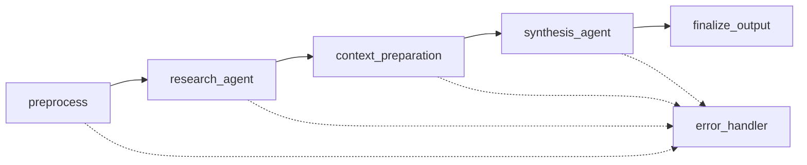

# Sequential pattern

In a sequential (pipeline) graph, each stage runs after the previous one and
passes its results on through the graph state. Conditional edges send the run
to an error handler when a stage fails.

The example is
`examples/langgraph-integration/design_patterns/sequential/research_agent/`: a
research pipeline with five stages and an error handler. Two stages are
LLM agents with tools; the others are deterministic AsyncFlow tasks.



## Run it

The agents use OpenRouter: set `OPEN_ROUTER_API_KEY`, then run
`make examples-sequential-research`. CI, which has no credentials, runs the
example with a scripted chat model in place of OpenRouter
(`tests/integration/test_design_patterns_offline.py`);
`tests/integration/test_integration.py` runs it live when
`FLOWGENTIC_RUN_LLM_INTEGRATION=1` is set.

## The graph

Every node is an `EXECUTION_BLOCK`, wrapped for the node report, and each
transition is a conditional edge:

```python
--8<-- "examples/langgraph-integration/design_patterns/sequential/research_agent/components/builder.py:build-workflow"
```

An edge function reads the stage's result from the state:

```python
--8<-- "examples/langgraph-integration/design_patterns/sequential/research_agent/components/edges.py:edge-after-research"
```

## An agent stage

The research stage builds an agent with `langchain.agents.create_agent`, gives
it two tools, and records its output in the state. A failure is appended to
`state.errors` and recorded as `success=False` in the stage's output, which the
next edge routes to the error handler:

```python
--8<-- "examples/langgraph-integration/design_patterns/sequential/research_agent/components/nodes.py:research-agent-node"
```

Its tools are `AGENT_TOOL_AS_FUNCTION` functions, so each tool call the model
makes runs as an AsyncFlow task:

```python
--8<-- "examples/langgraph-integration/design_patterns/sequential/research_agent/components/utils/actions.py:web-search-tool"
```

The example's tools return canned results after a short sleep; they stand in
for real search and analysis services.

## Running the graph

`main.py` opens the integration on a local backend, builds the graph and
compiles it with an in-memory checkpointer:

```python
--8<-- "examples/langgraph-integration/design_patterns/sequential/research_agent/main.py:start-app"
```

It then streams the run and writes the node report next to `main.py`; see
[Telemetry](../features/telemetry.md). A run that ends in the error handler
raises `RuntimeError` with the stages' errors, so it exits non-zero.

The variant `research_agent_memory/` adds a `MemoryManager`; see
[Memory](../features/memory.md).
