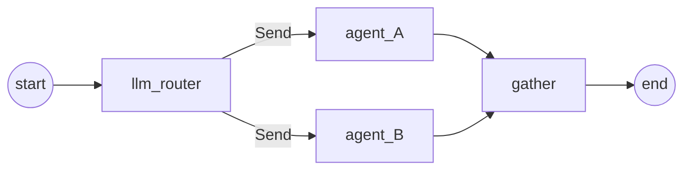

# Supervisor pattern

In a supervisor (router) graph, a router reads the request and selects the
worker agents to run. The selected workers run in parallel, and a gather node
combines their results.

The example is `examples/langgraph-integration/design_patterns/supervisor/toy/main.py`.
Its router is an LLM; its two workers are AsyncFlow tasks that sleep for 3 s
each, so a run that selects both shows them running at the same time.



## Run it

The router and the gather node use OpenRouter: set `OPEN_ROUTER_API_KEY`, then
run `make examples-supervisor-toy`. `tests/integration/test_integration.py`
runs the example when `FLOWGENTIC_RUN_LLM_INTEGRATION=1` is set; CI, which has
no credentials, skips it.

## The state

The workers write into `results`, whose reducer merges the dictionaries that
parallel workers return:

```python
--8<-- "examples/langgraph-integration/design_patterns/supervisor/toy/main.py:graph-state"
```

## The router

`create_llm_router(responsibilities, model)` (`flowgentic.langGraph.utils.supervisor`)
returns a node that asks the model which agents should handle `state.query`,
with structured output, and stores its choice in `routing_decision` and
`routing_rationale`. The example runs it as an `EXECUTION_BLOCK`:

```python
--8<-- "examples/langgraph-integration/design_patterns/supervisor/toy/main.py:router"
```

## The workers

```python
--8<-- "examples/langgraph-integration/design_patterns/supervisor/toy/main.py:workers"
```

## The graph

`supervisor_fan_out` returns one `Send` per agent in `routing_decision`, so
LangGraph runs the selected workers in parallel. The `path_map` lists the
agents the router may choose:

```python
--8<-- "examples/langgraph-integration/design_patterns/supervisor/toy/main.py:graph-wiring"
```

The nodes are wrapped with `agent_introspector.introspect_node` before they
are added, so the run writes a node report; see
[Telemetry](../features/telemetry.md). When both workers ran, the gather node
asks a second model, built with `langchain.agents.create_agent`, to combine
their outputs; with one worker, it passes the result through.

For an agent that hands work to another agent through a tool call, see
[Hand off to another agent](../guides/langgraph-on-asyncflow.md#hand-off-to-another-agent).
