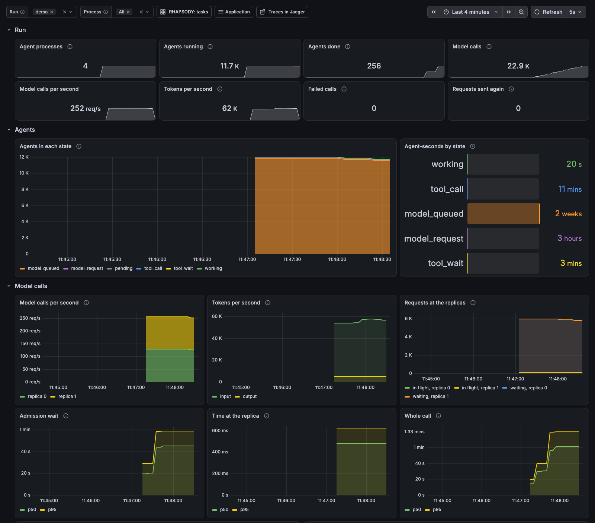

# Live dashboard

A run's telemetry can be watched while the run goes: the agents in each state,
the model calls and tokens per second, the requests waiting at each replica,
the tools, and each agent process's event loop. The `otlp` extra streams each
agent process's metrics and spans to an
[OpenTelemetry collector](https://opentelemetry.io/docs/collector/) over OTLP,
and `examples/live-dashboard` starts a collector, Prometheus, Jaeger and
Grafana, with dashboards, in one command.



The stream comes beside the per-process files that
[`read_export`](telemetry.md#read-an-export-back) reads, not in their place:
the files are a run's record, checked once it ends; the stream is for
watching it. `configure()` can write both.

## Start the dashboard

With Docker, one command starts the stack for the user who runs it:

```bash
examples/live-dashboard/stack.sh up
```

It prints Grafana's address and where its admin password is. Each user gets
ports of their own, from 20000 + (uid % 4000) × 10, so users of one node do
not collide:

| Port | Service |
| --- | --- |
| The first | Grafana, with Flowgentic's dashboard as its home page; it asks for a login, `admin` and the password `stack.sh` made |
| The second | The collector's OTLP/HTTP receiver, what `flowgentic.otlp` sends to |
| The third | The collector's OTLP/gRPC receiver |

Only these are published, on 127.0.0.1. Prometheus and Jaeger are reached
through Grafana: the dashboards for the metrics, Explore with the Jaeger data
source for the sampled traces (the dashboard's Traces link).
`stack.sh down` stops the stack; `stack.sh down -v` also drops Prometheus's
and Grafana's data. Jaeger keeps its traces in memory only.

`stack.sh` makes two secrets once and keeps them, readable by the user only,
in `~/.local/state/flowgentic-live/`: Grafana's admin password, and a token
the collector asks of every agent process. Its settings:

| Variable | Default | What it sets |
| --- | --- | --- |
| `BIND_ADDRESS` | `127.0.0.1` | The interface Grafana and the collector listen on |
| `GRAFANA_PORT`, `OTLP_HTTP_PORT`, `OTLP_GRPC_PORT` | The user's three ports above | The ports |
| `GRAFANA_ADMIN_PASSWORD`, `OTLP_TOKEN` | The kept secrets | The secrets |
| `GRAFANA_ANONYMOUS` | `false` | `true` lets anyone who reaches Grafana view the dashboards without a login |
| `APP_DASHBOARDS`, `HOME_DASHBOARD` | None | An application's dashboards; see [the dashboards](#the-dashboards) |

!!! warning "On a shared node"
    A port on 127.0.0.1 is closed to other machines, not to other users of
    the same one. Keep the login and the token: with `GRAFANA_ANONYMOUS=true`
    any user of the node can read the run's dashboards, and with the token
    known, write into them. Neither Grafana nor the collector uses TLS here:
    to cross a network, use an SSH tunnel rather than `BIND_ADDRESS=0.0.0.0`.

## Stream a run to it

Install the extra, `flowgentic[otlp]`, which adds `opentelemetry-sdk` and its
OTLP/HTTP exporter. Each agent process calls `configure()` once, before its
agent hosts run, as the agents-at-scale example does with `--otlp`:

```python
--8<-- "examples/agents-at-scale/campaign.py:otlp"
```

`configure()` sets the process's meter and tracer providers, so everything
that records through OpenTelemetry's global providers goes to the collector:
Flowgentic's metrics and spans, and the MCP SDK's and the GenAI
instrumentation's spans. Without an endpoint, it reads OpenTelemetry's
environment, which `stack.sh env` prints: the collector's address, and its
token as a header.

RHAPSODY keeps providers of its own, which `configure()` does not reach.
`rhapsody_options()` gives its session a metric reader and a span processor
that export to the same collector, with the process's resource, export
interval and shutdown bound:

```python
await session.start_telemetry(**telemetry.rhapsody_options())
```

AsyncFlow's `WorkflowEngine.start_telemetry()` takes the same options.
RHAPSODY builds its providers itself, so the rest is its own: its `session`
span is always kept; each `task` span is kept or dropped with the span that
submitted the task, so with its agent; its metrics keep the SDK's default
exemplars, which `OTEL_METRICS_EXEMPLAR_FILTER=always_off` turns off.

`start_telemetry()` also leaves RHAPSODY's `session` span current in the
caller's context, until the session closes. Agents started there would be
its children, and per-agent sampling would follow the session, which is
always kept: every agent would keep its spans, all in one trace. Start the
agents in a context of their own, as the example does:

```python
from opentelemetry import context, trace

token = context.attach(trace.set_span_in_context(trace.INVALID_SPAN))
try:
    report = await host.run_indexed(...)
finally:
    context.detach(token)
```

When the run ends, `telemetry.shutdown()` exports what is left.

The example runs a campaign long enough to watch, on a laptop. RHAPSODY's
node panels need its `telemetry` extra, which polls each node:

```bash
source <(examples/live-dashboard/stack.sh env)
uv run --extra agents --extra otlp --with "rhapsody-py[telemetry]" \
    python examples/agents-at-scale/campaign.py \
    --agents 12000 --processes 4 --otlp --model-latency 0.5
```

`--otlp` takes the collector's URL, or without one reads the environment, and
`--run` the run's name on the dashboard. `--model-latency` makes each scripted
model call take that long, here half a second, so the fleet's admission holds
most agents queued: about 2.5 minutes for 36,000 calls.

### What `configure()` sets

The defaults are the [telemetry page's configuration at scale](telemetry.md#what-it-costs-and-how-to-cut-it),
with metrics every 5 s rather than 10 s, for a live view; see
[what it costs](#what-it-costs):

| Argument | Default | What it sets |
| --- | --- | --- |
| `endpoint` | OpenTelemetry's `OTEL_EXPORTER_OTLP_ENDPOINT`, then `http://localhost:4318` | The collector's OTLP/HTTP base URL; the exporters add `/v1/metrics` and `/v1/traces` |
| `run` | `OTEL_RESOURCE_ATTRIBUTES` | `service.namespace`: the run, or campaign |
| `service` | `OTEL_SERVICE_NAME`, then `flowgentic` | `service.name`: the process's role in the run, such as `agents` |
| `instance` | `OTEL_RESOURCE_ATTRIBUTES`, then the host's name and the process id | `service.instance.id`: the process, one per process |
| `sample` | 0.1 | The share of agents whose spans are kept, each with its whole trace: `ParentBased(TraceIdRatioBased(sample))` |
| `exemplars` | `False` | The SDK's default exemplar filter, which keeps an exemplar for each value recorded inside a sampled span |
| `interval_s` | 5 | Seconds between metric exports, the files' too |
| `spans` | `True` | `False` exports metrics only |
| `files` | `None` | A directory for `metrics.jsonl` and `spans.jsonl` as well, as `read_export` reads them |
| `timeout_s` | `OTEL_EXPORTER_OTLP_TIMEOUT`, then 10 | Seconds an export waits for the collector, retries included; it also bounds a shutdown |

An argument given wins over the environment, which wins over the defaults.
The metrics count every agent and call whatever the sampling, and they are
cumulative, whatever `OTEL_EXPORTER_OTLP_METRICS_TEMPORALITY_PREFERENCE`
says: an export that fails, as when the collector is down, is dropped, and
the next one carries the totals. The agents never wait for the collector.

With the collector down, `shutdown()` takes about `timeout_s` for the
metrics and as much for the spans, and drops the spans still queued; so
does RHAPSODY's session when it closes, with the processor
`rhapsody_options()` gave it. Each span processor sending to the collector
holds 8,192 spans, about 30 MB while the collector is down, and drops more.
The exporters log each failed export.

`configure()` refuses a process whose meter or tracer provider is set
already, with `RuntimeError`: the SDK keeps the first provider, and the
telemetry would not reach the collector.

The exporter is OTLP over HTTP with protobuf, OpenTelemetry's default
protocol, rather than gRPC: it needs no `grpcio`, a large native wheel whose
fork handling is a risk with `multiprocessing` and on HPC nodes, and one HTTP
port passes through a tunnel or a proxy.

## A campaign of many agent processes

Each agent process calls `configure()` with the same `run` and an `instance`
of its own, such as its index or its rank, and sends to the same collector.
The dashboards then show the whole run, summed over the processes, or one
process, chosen at the top:

| Variable | Label | From |
| --- | --- | --- |
| Run | `service_namespace` | `run` |
| Process | `service_instance_id` | `instance` |

On an allocation, run the stack where the agent processes can reach the
collector, such as on the node that starts the campaign, and give each
process the environment `stack.sh env` prints. To keep the collector
private there, bind it to the allocation's internal interface
(`BIND_ADDRESS`) rather than every interface, keep its token, which only
the processes' environment carries, and reach Grafana from outside through
an SSH tunnel to its port on 127.0.0.1. Each process sends one metrics
request per export interval, about 9 kB for the agents-at-scale example's
metrics, and its sampled spans in batches of about 100 kB.

Call `configure()` in each process after it starts, as the example's
spawned processes do. A process forked after `configure()` sends under a
new random `service.instance.id` (OpenTelemetry's SDK 1.45), even one
`configure()` was given.

A model server's own metrics, such as vLLM's, go to the same Prometheus:
`collector.yaml` shows a `prometheus` receiver that scrapes a server's
`/metrics`.

## The dashboards

Grafana holds one folder for each component of the stack, and one for the
application:

- **Flowgentic: agents at scale.** The processes, agents running and done,
  model calls, calls and tokens per second, failed calls and requests sent
  again; the agents in each state over time and the agent-seconds by state;
  model calls per second by replica, tokens per second by type, requests in
  flight and waiting at each replica, the admission wait, the time at the
  replica and the whole call (median and 95th percentile), requests sent
  again and outages, and failed calls by error; tool calls per second and
  the tools' 95th-percentile duration; and each process's event-loop lag and
  time in garbage collection.
- **RHAPSODY: tasks.** Tasks submitted, completed, failed, canceled and
  running; tasks per second; the mean task duration by backend; and each
  node's CPU, memory and GPU utilization, as RHAPSODY's backends poll them.
- **Application.** An application's own dashboards, from a directory given as
  `APP_DASHBOARDS`, such as a view of the whole application with links to the
  components' dashboards. `HOME_DASHBOARD` makes one of them Grafana's home
  page:

```bash
APP_DASHBOARDS=/path/to/dashboards \
HOME_DASHBOARD=/var/lib/grafana/dashboards/application/overview.json \
    examples/live-dashboard/stack.sh up
```

Prometheus names a metric after its OpenTelemetry name and unit, with dots
turned into underscores, `_seconds` for a duration, and `_total` for a
counter: `flowgentic.agents` is `flowgentic_agents`,
`flowgentic.fleet.call.duration` is `flowgentic_fleet_call_duration_seconds`,
and `flowgentic.fleet.tokens` is `flowgentic_fleet_tokens_total`. Attributes
are labels named the same way, such as `flowgentic_agent_state`.

## What it costs

Streaming costs the agents' process what writing the files costs: the SDK
does the same work per value and per span, and the OTLP exporter encodes
protobuf where the console exporter writes JSON. Measured with the
benchmarks' `--otlp` option into `benchmarks/otlp_sink.py`, an endpoint that
takes the exports and keeps nothing (22 Nov 2026, AMD EPYC 7502P, Python
3.14, the whole process's CPU, median of 5 runs on the loop and 7 for the
host alone):

| SDK, against none | 5,000 agents on the loop (`agent_loop.py`): metrics, a tenth of the agents' spans | The agent host alone, 100,000 agents (`agent_host.py`): metrics |
| --- | --- | --- |
| The files `read_export` reads, metrics every 10 s | +17.4 % | +0.0 % |
| OTLP, metrics every 10 s | +17.7 % | +3.8 % |
| OTLP, metrics every 5 s | +18.4 % | +2.2 % |
| OTLP and the files | +21.0 % | not measured |

The runs vary by about 1 %. The host's run lasts 1.8 s, less than an
interval, so it pays for one export, at the end, which also opens the
connection. Writing the files beside the stream exports each kept span twice:
3 % more than the files alone.

One metrics export, once 5,000 agents on the loop have filled every
instrument, costs 1.5 ms of CPU over OTLP and 2.5 ms as a JSON line; the
first costs about 5 ms. Every 5 s, that is about 1 s of CPU an hour per
process, which is why `configure()` exports twice as often as the telemetry
page's configuration. The spans are what costs: the page's
[levers](telemetry.md#what-it-costs-and-how-to-cut-it) apply as they are,
sampling first.

The benchmarks turn on no RHAPSODY telemetry. The agents-at-scale example
does, with `--otlp`: RHAPSODY then handles an event per task, polls the
nodes, and keeps the task spans of the kept agents. With 3,000 agents in one
process on a laptop, the example took 25 % more CPU with `--otlp` than
without, imports included (median of 3 runs).

## Limitations

- `flowgentic.agents` counts the agents of runs in progress only, so "Agents
  done" drops to 0 when a process's run returns; the model calls and tokens
  are totals.
- Prometheus shows a process's series for 5 minutes after its last export.
- RHAPSODY's task duration has the SDK's default buckets, too coarse for the
  quantiles of short tasks, so the dashboard shows its mean.
- With exemplars off, a metric's point does not link to a trace.
- Grafana's Explore, where the Traces link leads, is for logged-in users:
  anonymous viewers see the dashboards only.
- Flowgentic's events are log records, and `configure()` sets no logger
  provider: they are not streamed.

## API

- [`flowgentic.otlp`](../api/flowgentic/otlp.md)
