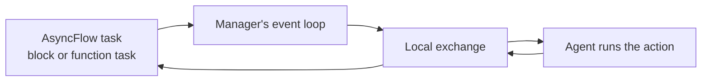

# Academy actions as AsyncFlow tasks

An AsyncFlow task can call the actions of an [Academy](https://academy-agents.org)
agent directly. An agent keeps its state between calls, so a workflow can
consult or update it from any task. Flowgentic adds no module for this: two
small helpers do it, and this page shows them and says why each is needed.

The code on this page comes from `examples/academy-integration/direct/run.py`,
which `tests/integration/test_academy_examples.py` runs in CI.
`tests/integration/test_academy_on_asyncflow.py` shows the failures the two
helpers prevent.

## 1. Install Academy

The example needs academy-py 1.0 beside AsyncFlow. From a clone, the
`examples` extra brings it:

```bash
uv sync --locked --extra examples
```

In your own project, require `academy-py>=1.0,<2`.

## 2. Define an agent

An Academy agent is a class whose `@action` methods other code can call
through a handle. This counter keeps its count between calls:

```python
--8<-- "examples/academy-integration/direct/run.py:agent"
```

## 3. Two helpers

```python
--8<-- "examples/academy-integration/direct/run.py:helpers"
```

`bind` gives a handle its exchange client. The handle that `Manager.launch`
returns finds its client through Academy's `exchange_context` variable, which
the manager sets for the code that entered it. AsyncFlow tasks do not carry
that variable: a block runs in the engine's context, and a function task in a
worker thread. There, an unbound handle raises `ExchangeClientNotFoundError`.

`on_loop` awaits the action on the manager's event loop. A function task on a
thread-pool backend runs in a worker thread, under its own event loop, but the
handle's reply arrives on the manager's loop. Awaited on the worker's loop,
the call returns only when that loop next wakes for another reason, and if
nothing wakes it, never. A block already runs on the manager's loop, so
`on_loop` awaits it directly.

## 4. Call actions from tasks

```python
--8<-- "examples/academy-integration/direct/run.py:tasks"
```

The application launches the agent before its tasks call it. Academy queues
requests until the agent's `agent_on_startup` returns, so the first call needs
no wait. Leaving the manager's context shuts down every agent it launched.

To run the example:

```bash
uv run --extra examples python examples/academy-integration/direct/run.py
```

## How a call runs

The agent does not run on the task's backend. With no executor, the manager
runs its agents on the event loop that entered it, which is AsyncFlow's loop.
A task sends the action through the manager's exchange and waits for the
result:



The agents share the loop with AsyncFlow, so an action that blocks, such as a
long computation, belongs in `Agent.agent_run_sync`, which runs it in a
thread. Do not give the manager a `ThreadPoolExecutor` instead: each running
agent holds one of its workers for its whole life, and agents beyond the
pool's size never start.

A process-pool or remote backend cannot reach the manager, so its tasks
cannot call these agents. Wrapping an action in an AsyncFlow task gives it a
place in the workflow's records and dependencies, not a place on the task's
resources.

## Limitations

This recipe is tested with Academy's local exchange and AsyncFlow's local
backend only. Placing Academy agents on HPC resources, or letting an agent
drive the workflow, is outside Flowgentic: the first is a placement concern
for RADICAL's execution layer, and the second a decision concern for ADR.

Flowgentic 0.3 shipped a module for this, `flowgentic.academy`. The
[Academy substitution check](../evaluation/academy.md) compared it with these
direct calls and found that it added no capability, so 0.4.0 removed it.
