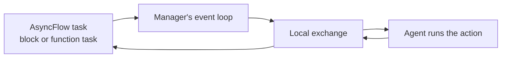

# Academy actions as AsyncFlow tasks

`flowgentic.academy` runs the actions of [Academy](https://academy-agents.org)
agents as AsyncFlow tasks. An agent keeps its state between calls, and a
workflow calls its actions as it calls any other task: as a function task, a
block, or a chain of blocks.

The code on this page comes from `examples/academy-integration/01-actor-client/run.py`,
which `tests/integration/test_academy_examples.py` runs in CI.

## 1. Install the `academy` extra

Academy is an optional dependency. From a clone:

```bash
uv sync --locked --extra academy
```

To install the wheel from [Getting started](../getting-started.md#install)
with Academy, add the extra to the wheel's path:
`"dist/flowgentic-<version>-py3-none-any.whl[academy]"`. The extra requires
`academy-py>=1.0,<2`. Without it, `import flowgentic.academy` raises an
`ImportError` that names the extra.

## 2. Define an agent

An Academy agent is a class whose `@action` methods other code can call. This
counter keeps its count between calls:

```python
--8<-- "examples/academy-integration/01-actor-client/run.py:agent"
```

## 3. Call its actions from AsyncFlow tasks

`AcademyIntegration` takes the workflow engine. Entering it starts an Academy
manager with a local exchange; leaving it shuts down every agent it launched.
`create_agent_task` returns a coroutine function that calls one action, and a
workflow wraps it, or a function that awaits it, in an AsyncFlow task:

```python
--8<-- "examples/academy-integration/01-actor-client/run.py:tasks"
```

Both tasks name the same agent: `agent_id` defaults to the class name. The
first call for an `agent_id` launches the agent and waits until it answers a
ping, which it does once its `agent_on_startup` has returned. Concurrent first
calls launch it once. `startup_timeout` bounds that wait (60 s by default);
after it, the agent is shut down and the call raises `asyncio.TimeoutError`.

To run the example:

```bash
uv run --extra academy python examples/academy-integration/01-actor-client/run.py
```

## How a call runs

The agent does not run on the task's backend. The manager and its agents run
on the event loop that entered `AcademyIntegration`, which is AsyncFlow's
loop. A task sends the action through the manager's exchange and waits for the
result:



A block runs on that loop. A function task on a thread-pool backend runs in a
worker thread, under its own event loop, and submits its call to the
manager's loop. A process-pool or remote backend cannot reach the manager, so
its tasks cannot call agents.

The agents share the loop with AsyncFlow, as Academy's manager runs them by
default. An action that blocks, such as a long computation, belongs in
`Agent.agent_run_sync`, which runs it in a thread.

## Agents with loops

An agent's `@loop` methods start after `agent_on_startup` returns, so they are
scheduled by the time the first call returns. `startup_delay` adds a wait after
the launch for loops that need a head start;
`examples/academy-integration/02-agent-loop/run.py` uses it.
`ensure_agent_loops_running` and `wait_for_all_agent_loops` only wait the time
they are given: they do not check the loops.

## Chains

`create_workflow_from_academy_chain` takes a list of
`(agent_class, action_name, args, kwargs)` tuples and returns a coroutine
function. Each action runs as a block on its own agent, and each result is the
next action's argument.

## Limitations

The integration is tested with Academy's local exchange and AsyncFlow's local
backend only. It creates its own manager and exchange, so agents on Redis,
HTTP or Globus exchanges, or launched on other executors, are out of its
reach.

The [Academy substitution check](../evaluation/academy.md) runs the concurrent
counters of the first example with and without the integration. The direct
version, with Academy calls inside AsyncFlow tasks, is in
`tests/integration/test_academy_substitution.py`.
